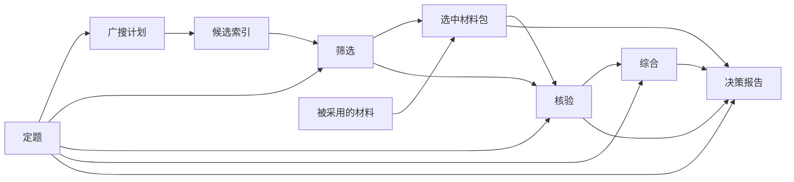

# 依赖图与局部重做

目标：修正前面的某个问题时，保留已完成工作；明确哪些内容仍可用、哪些依赖已改变，以及究竟需要重做哪一部分。

## 图里保存什么

每次调研目录保存 `graph.json`，记录节点、当前版本、依赖的具体上游版本与变更历史；产物以独立版本保存在 `artifacts/`。阶段卡也按版本作为输入记录。它们是程序状态，不是每次发给模型的新规则。

节点包含定题、广搜、筛选、选中材料、核验、综合、决策，以及每份候选的摘要和正文。边表示实际消费的数据，而非单纯“谁排在谁后面”。



这是主干示意，实际实例图还包含请求、阶段卡、各份来源与候选投影节点。

## 变更的含义

- **invalidate**：标记某节点需要重做；旧版本仍在，依赖它的后续节点变为 stale。
- **replace**：导入明确修正后的新版本，检查结构与引用；不会覆盖历史版本。
- **undo**：当前指针退到上一个版本；没有上一个版本时变为未完成，旧内容仍可查。
- **restore**：选择指定历史版本。仅当依赖版本也匹配时恢复为 fresh，不能凭“恢复”跳过依赖检查。
- **resume**：复用仍有效的结果，重建失效节点和真实依赖它的后续。广搜依赖变了才重新采集。

fresh 表示依赖版本一致；不代表内容已经被事实证明正确。stale 表示需要复核/重算；不表示旧结论必然错误。

## 三个例子

1. 只修正未采用来源的正文，摘要和筛选依据未变：现有核验、综合和报告保持有效，不重新调用模型。
2. 修正采用来源的正文：复用定题、广搜和筛选；重建选中材料包、核验、综合和报告。
3. 人工修正核验结果：保留该修正，复用此前材料；只重做综合与决策。失败的重做不会取代已提交版本。

修改影响真实使用的内容/条件时应同步修正摘要和引用；图不自动推断隐藏的语义关系。当前自动调研的核验与综合以整个阶段为节点，尚未拆成每个产品/每条主张的独立子图；通用图引擎支持分支，后续可逐步细分。

## 命令

在 Research 目录执行，`RUN` 换成一次调研目录；报告 frontmatter 中有对应的 `run_graph`。

```sh
python3 scripts/industry_graph.py status RUN
python3 scripts/industry_graph.py graph RUN
python3 scripts/industry_graph.py history RUN --node verify
python3 scripts/industry_graph.py invalidate RUN --node verify --reason '需要重新核查'
python3 scripts/industry_graph.py replace RUN --node verify --file corrected.json --reason '修正证据解释'
python3 scripts/industry_graph.py undo RUN --node verify --reason '撤销此次修改'
python3 scripts/industry_graph.py restore RUN --node verify --revision rev-xxx --reason '恢复已核对版本'
python3 scripts/industry.py --resume RUN
python3 scripts/industry.py --resume RUN --force verify
```

重新生成仍可能调用模型或搜索。`status / graph / history` 只读。手动修改用导入命令，不直接改 `artifacts/`；文件有校验，篡改不会被当作合法修订。

旧报告保留为对应版本的快照；发布新报告前会检查图状态，阻止把已失效的结果重新当作最新报告发布。图里未跟踪的外部事实变化仍需人工或采集任务提出更新，不能假设系统已自动知道。

## 版本与进度怎样看

Obsidian 的 [[研究路线/运行总览]] 是固定入口，[[今日简报]] 顶部可进入。每次真实运行图状态变更会刷新本地页面；`publish_review.py` 同步到 iCloud，手机收到更新仍取决于 iCloud。

| 要追踪的东西 | 保存位置 | 能回答什么 |
| --- | --- | --- |
| 代码、schema、阶段卡和说明 | Git 本地提交 | 当时执行的规范与实现是什么 |
| 当次实际实现 | 运行元信息、每次执行记录的 Git 和文件哈希 | 未提交修改下究竟用了什么文件版本 |
| 材料与生成产物 | 每次运行的不可变 artifacts 与 graph.json | 用了哪个上游版本，哪些后续要重做 |
| 执行进度 | attempts 最新执行 + events 历史事件 | 何时开始/结束、复用/失败、耗时、错误类型 |
| 模型调用输入 | attempts 各次 request.json、schema、输出与日志 | 当时的任务、材料和阶段标准是什么 |

执行状态（running/completed/cached/failed）与产物有效性（fresh/stale/missing）分开。重做失败不会抹掉旧产物；产物已完成也可能因依赖变化而待复核。6 个阶段的完成数不是可信度、研究进展或预计耗时百分比。

当前状态管理是本项目的本地运行记录，还没有接入开源编排服务。已调研 Prefect（运行状态/调度）、Dagster（持久产物依赖）、DVC（数据与管线复现），来源和选择依据见总览。若升级到跨进程队列和 Web 运维，优先验证 Prefect 适配；当前官方版要求 Python 3.11+，与本机默认 3.9 隔离安装。现有模型调用仍使用 knowledge.py 内的有限重试，尚无编排器级断点或调度 SLA。

Git 提交与产物哈希提供追溯；外部网页、模型服务和配置可能变化，因此不声称逐字可复现。现有旧报告不会自动迁移成已验收的新图任务。
